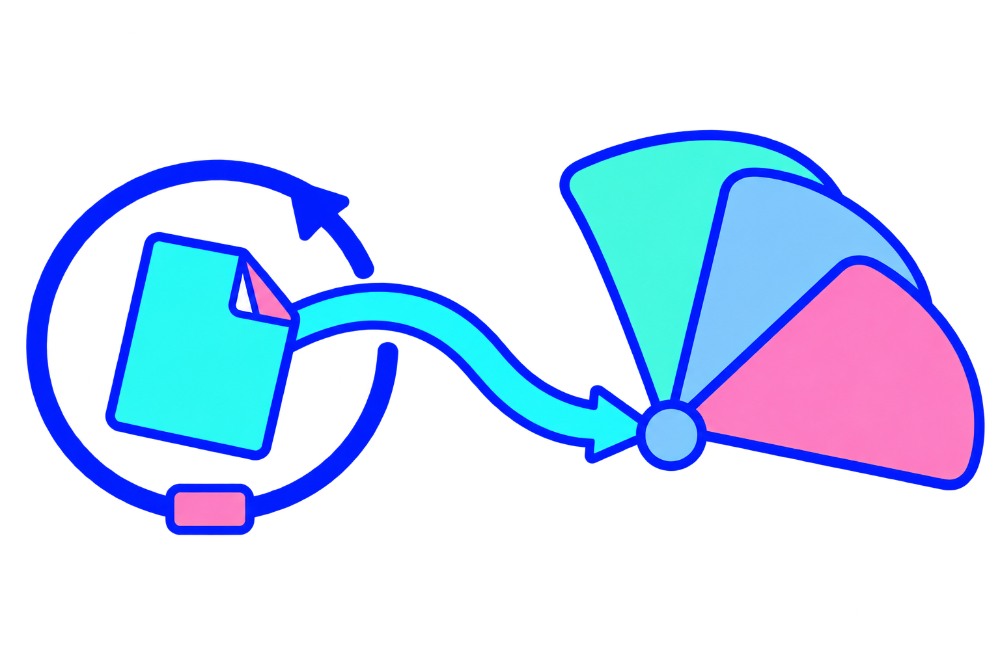
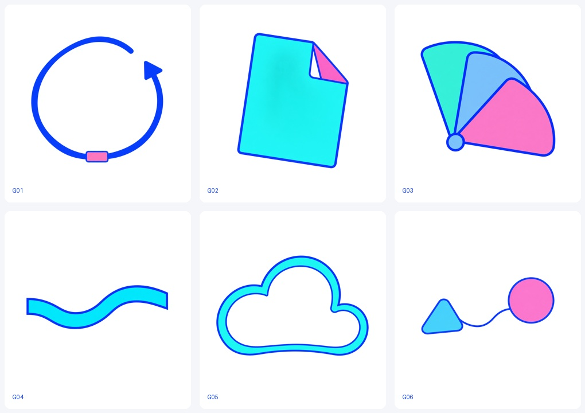

# FlowUs Geometric Studio

A reusable, unofficial illustration skill with natural-language briefs and a small original geometric material kit.

以息流网站已筛选的几何／线条语法为研究依据，创作新内容配图。**0.1.5 是试用版**：先理解自然语言，再选择角色、物件或无人物几何素材，避免所有抽象内容都变成立方体。

[MIT许可](LICENSE) · [Skill入口](SKILL.md) · [验证记录](validation/report.md) · [第三方来源](references/source-catalog.md) · [版本记录](CHANGELOG.md)

## 先看实际效果

**A · 一起走一段**：一位邻居邀请没带伞的人同行。共伞首图获用户评价“适合，可以直接使用”；助手仍保留动作根部和线重问题。


**B · 先试一小步**：小范围试用、反馈调整，再扩大范围。原方块首图被指出选形单一，随后先生成小素材，再实际组合并修正路线。用户认可当前组合方向并以本版截止；它仍是抽象隐喻。



## 六件原创小素材



G01开放回环、G02折页信息片、G03展开扇片、G04回折连接带、G05留白云形容器、G06异形接点。每件是独立透明PNG，位于[素材目录](assets/geometry-kit)。先按语义挑少量素材；没有合适形体就新造，库不反过来限制内容。

这六件是原创扩充，不是官网图片裁切。蓝色轮廓、少量色面与形体关系保持共同语法；轻微面内明暗和线重差异仍有保留。B实际传入G02/G01/G03/G04，再做一次路线编辑；生成式组合会重绘，不能视为固定像素拼接。

## 安装与使用

把本仓库作为一个完整Skill目录安装，已有同名版本先备份：

```sh
git clone https://github.com/luyuzhe-1/flowus-geometric-studio.git ~/.codex/skills/flowus-geometric-studio
```

在支持本地Skill的Codex环境中使用：

> 使用 $flowus-geometric-studio，为这段内容配一张图：团队先让少量用户试用新功能，根据建议调整，再逐步开放给更多人。

也可以指定内容配图、人物、独立物件、装饰或原创Logo概念，以及比例、背景和留白。用户内容覆盖默认。Logo是位图概念，不冒充可编辑矢量。

第三方参考不随仓库分发。按任务从[来源目录](references/source-catalog.md)只看2–3张；需要离线原始文件时可运行：

```sh
python3 scripts/fetch_references.py R03 R12
```

下载保留SVG／WebP等原生格式，并核对研究时记录的SHA-256。SVG按你的环境浏览或渲染；下载目录已忽略，不自动纳入MIT范围。脚本只用Python标准库。

下载后可直接打开[本地浏览页](docs/gallery.html)查看原文、素材与输出。

## 验证边界

本轮先冻结两段自然语言和语义检查点，再各做一次首生、自评，随后收用户意见。A被选用；B进入“6素材首生→实际素材组合→一次路线编辑”流程。共8张首生、1次组合、1次针对性编辑，首次失败均保留。

- 首生只传文字与透明参数；看过网站参考不等于显式传入生成器。
- E06确实输入4件原创素材，但把外扩方向画反；E07修正后仍保留抽象反馈语义和色面问题。
- 内容图实际1536×1024；素材实际1254×1254，没有兑现提示词的1024×1024，未重采样冒充。
- 助手先行自评与用户评价独立；两例由助手提出，不是用户独立留出，不报告成功率。
- 开源版把第三方参考转为来源链接；未另做新环境自动发现与完整出图实测。

此前0.1.0–0.1.4是本地研究原型。本仓库从0.1.5开始公开，完整历史原始研究库留在本地；此仓库包含当前完整Skill、原创素材、实际提示词和本轮验证记录。

## 许可与来源

本项目原创内容采用MIT许可。第三方FlowUs素材只提供来源链接，许可范围见[NOTICE](NOTICE.md)。本项目不代表FlowUs官方，也不分发其原图或真实品牌标识。
